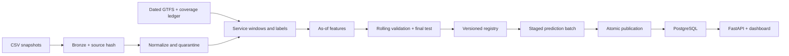

# TTC Subway Delay Risk

**A reproducible batch-ML system for line-station-hour recorded-event risk.**

[](https://github.com/NotMyFault8/ttc-subway-delay-risk/actions/workflows/ci.yml)

Immutable ingestion → GTFS windows → point-in-time features → temporal model evaluation → versioned batch predictions → PostgreSQL and FastAPI.

**Status:** runnable research prototype with a fully labelled synthetic demonstration and a separate audit of real TTC data. Real-world predictive validity remains unverified; demo probabilities are not TTC forecasts. This project is independent of TTC and the City of Toronto.

## Try it in five minutes

Python 3.10–3.12:

```sh
python -m venv .venv
. .venv/bin/activate
pip install -r requirements.lock
pip install --no-deps .
python -m unittest discover -s tests -v
ttc-pipeline demo --root data/demo
DATABASE_URL=sqlite:///data/demo/predictions.db uvicorn ttc_subway_delay_risk.api:create_app --factory
```

Open **http://127.0.0.1:8000**, select **2025-07-01**, and view the ranking. Interactive API documentation is at `/docs`. The demo deliberately returns HTTP 503 from `/ready`: historical synthetic results do not make a production service ready.

### PostgreSQL deployment

```sh
cp .env.example .env
# Set a local alphanumeric password in .env.
docker compose up -d --build api
docker compose --profile demo run --rm demo
```

The API binds to localhost. PostgreSQL stays on the private Compose network. Model artifacts and source data are excluded from Git.

## What is implemented

| Layer | Capabilities |
| --- | --- |
| Ingestion | HTTPS retries, SHA-256 source versions, immutable raw snapshots, schema checks, row quarantine |
| Samples | Dated GTFS subway services, calendar exceptions, after-midnight times, coverage-aware labels |
| Features | Shared as-of feature builder; calendar, scheduled stop visits, station/line historical frequencies |
| Evaluation | Baseline, logistic regression, CatBoost; three temporal folds and a held-out final period |
| Registry | Code/data hashes, dependencies, seed, metrics, versioned artifacts, manual release and rollback |
| Batch serving | Idempotent staged batches, transactional publication, baseline fallback and explicit status |
| API | Health, readiness, paginated predictions, risk ranking, model version and compact dashboard |
| Operations | Run ledger, Docker/PostgreSQL, daily timer template, CI and recovery tests |

## Architecture



## Evidence, not promises

**Real-data readiness:** the official City catalogue has been independently inspected, but no raw TTC file or historical GTFS snapshot is committed and no real-data metrics are claimed. The parser accepts the documented subway fields (`Date`, `Time`, `Line`, `Station`, `Code`, `Min Delay`) and blocks training until coverage, dated schedules, and availability evidence are reviewed. [Source assessment](docs/data-assessment.md).

**Synthetic evaluation:** 2,184 windows across 182 days. The validation gate selected the historical-frequency baseline. The final test is preserved for all three candidates; no test-period result changes model selection. [Evaluation report](docs/evaluation.md) · [Detailed metrics](reports/demo-evaluation.json).

**Verification:** tests cover data leakage, calendars, DST, revisions, quarantine, replay, publication, corrupt-artifact fallback and API constraints. See [operations evidence](docs/operations.md) for measured local deployment checks and limitations.

## Work with real data

```sh
ttc-risk --file /path/to/ttc-subway-delay-data-since-2025.csv --output data

ttc-dataset --schedules schedules.json --events events.json \
  --coverage coverage.json --start 2025-01-01 --end 2025-06-30 \
  --codes REVIEWED_CODE --output data/windows.json

ttc-pipeline train --dataset data/windows.json --evidence evidence.json
# Review the generated candidate report before release:
ttc-pipeline release --version CANDIDATE_VERSION
```

The evidence file is a manual research attestation, not an automatic proof. Do not set its flags without documented source review. [Input contracts and runbook](docs/operations.md) explain manifests, backfills and publication.

## Design boundaries

- No event record means **no recorded event**, not proof of punctual vehicles.
- Historic features use only labels available at the prediction cutoff.
- Current GTFS cannot establish historical service; missing coverage leaves labels unknown.
- The implementation uses Python transformations, SQLAlchemy and a systemd timer to keep a single-machine deployment small. Airflow, dbt, MLflow and cloud infrastructure are not implemented.
- The sample unit is **line × station × operating hour**, labelled by an incident start at that station. Frequency-based GTFS requires explicit expansion and is rejected. Legacy Excel files require a separate parser.
- Cloud deployment, real-data model validation, a 14-day operating record and cloud cost measurement remain outstanding. No SLA or operational business improvement is claimed.

## Code map

`pipeline.py` ingestion · `gtfs.py` calendars · `dataset.py` labels · `features.py` as-of statistics · `model.py` evaluation/registry · `run.py` batch commands · `store.py` transactions · `api.py` queries/dashboard.

[Engineering decisions](docs/engineering.md) · [Data assessment](docs/data-assessment.md) · [Evaluation](docs/evaluation.md) · [Operations](docs/operations.md)
